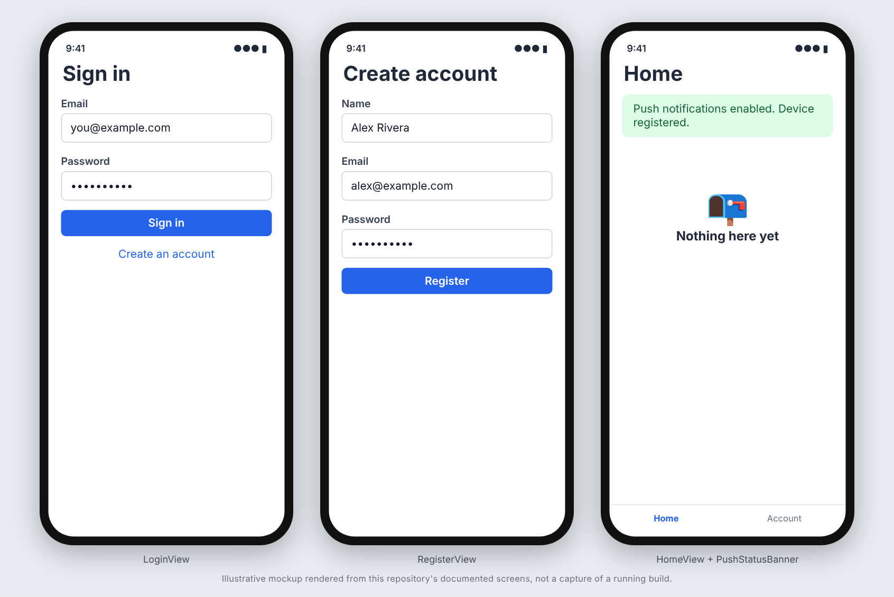

# iOS SwiftUI starter

A SwiftUI app skeleton driven by XcodeGen: GraphQL over HTTP and WebSocket on `URLSession`, Keychain token
storage, sign-in/register, APNs registration, deep linking from a push tap, and a macOS CI workflow. No domain
code, no third-party Swift dependencies.

## Screenshots



_These images are illustrative mockups rendered from this repository's documented screens and API shapes, not captures of a running build. Regenerate or replace them with real captures once the app is running._

## What is included

- `project.yml`: XcodeGen spec (app + unit-test targets, ad-hoc signing for Simulator builds). The `.xcodeproj`
  is generated, never committed.
- `Networking/`: `GraphQLClient` (query/mutation over HTTP, bearer token), `GraphQLSubscriptionClient`
  (`graphql-transport-ws` actor), `GraphQLClientError`, `JSONDecoder.api` (ISO-8601 with/without fractional
  seconds), `StarterAppEndpoint` (host via the `StarterAppHost` Info.plist key; plaintext only for the default
  local host, or with an explicit `StarterAppAllowInsecureHTTP` opt-in).
- `Auth/`: `KeychainStore` (single access token), `AuthService` (`register`/`login`/`me`).
- `App/`: `AppSession` (composition root), `AppDelegate` (APNs callbacks, all app states), the `@main` app.
- `Push/`: `PushRegistrationService`, `PushStatus` (permission/registration problems surfaced to the user),
  `NotificationPayload` (`itemId` custom key), `DeepLinkCoordinator` with a generic `AppRoute`.
- `Views/`: `RootView` (auth gate and route handling), login, register, `PushStatusBanner`, placeholder `HomeView`.
- `Views/Components/`: shared UI: `LoadingView`, `ErrorStateView` (optional retry), `EmptyStateView` (optional
  action) and `PrimaryButtonStyle` (`.buttonStyle(.primary)`). The sign-in button, the session-restore
  spinner and the home screen's empty profile state use them.
- `Tests/`: `StubURLProtocol`-based tests for the client, auth, push registration, endpoint scheme, JSON dates,
  Keychain, payload parsing, deep links, push status and the shared views.
- `.github/workflows/ci.yml`: macOS build and test on a Simulator, gitleaks, CodeQL for Swift and for Actions.

## Use the template

```bash
./rename.sh com.acme.myapp "My App"
# fill in LICENSE, then on a Mac:
brew install xcodegen && xcodegen generate
xcodebuild test -project MyAppIOS.xcodeproj -scheme MyAppIOS \
  -destination 'platform=iOS Simulator,name=iPhone 16'
```

Adjust the GraphQL operation and field names in `AuthService`, `PushRegistrationService` and the `User` /
`DeviceTokenInfo` models to your schema. Add new operations as a plain `struct` wrapping `GraphQLClient`.

## Push notifications

Real delivery needs an APNs-capable backend, a push entitlement and a physical device; the Simulator cannot
receive Apple-delivered pushes. Never commit `.p8`/`.p12` keys or provisioning profiles (gitignored).

## Not verified

This template was assembled in a Linux sandbox with no Xcode or Swift toolchain, so nothing here has been
compiled or run. The first run of the macOS CI job is the verification, and may need small fixes.
